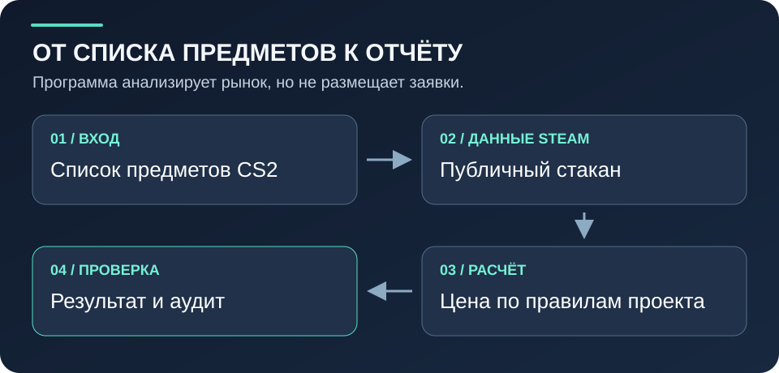
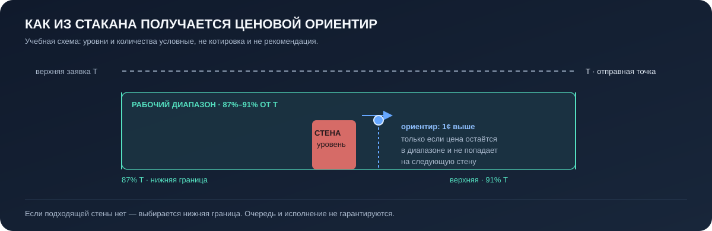

# SO Engine · рынок заявок, без магии

<p align="center">
  
</p>

<p align="center"><strong>Цена по открытому стакану CS2 — как рекомендация для анализа, не как обещание сделки.</strong></p>

<p align="center">
  <a href="#быстрый-старт"><strong>Быстрый старт</strong></a> ·
  <a href="#как-проходит-расчёт"><strong>Алгоритм</strong></a> ·
  <a href="#настройки-и-практические-ограничения"><strong>Безопасность</strong></a>
</p>

---

## Что это

**SO Engine (Steam Order Engine)** — Python-программа для анализа публичной книги заявок Steam Community Market и расчёта ориентировочной цены buy order для предметов CS2. Она получает текущие данные рынка, применяет фиксированное ценовое правило и записывает результат вместе с аудитом.

Инструмент подходит, когда нужно:

- сравнить список предметов по одной и той же ценовой политике;
- увидеть, какие уровни заявок алгоритм считает структурными стенами;
- распределить заданный бюджет по рассчитанным ценам;
- сохранить checkpoint и проверить, почему строка прошла, была пропущена или не рассчиталась.

**Это не торговый бот и не финансовая рекомендация.** SO Engine не входит в аккаунт Steam, не размещает и не отменяет заявки, не покупает и не продаёт предметы. Расчёт не гарантирует исполнение, прибыль, срок ожидания или будущую ликвидность.

## Как проходит расчёт

<p align="center">
  
</p>

1. Программа проверяет имя предмета и запрашивает публичную страницу Steam Market и данные стакана через HTTPS.
2. Кумулятивные количества в `buy_order_graph` преобразуются в количества заявок на отдельных ценовых уровнях.
3. Верхняя положительная заявка задаёт **фиксированный диапазон на 9–13% ниже неё**. Цены считаются целыми центами.
4. Внутри диапазона ищутся структурные стены: уровень проходит, если заявок не меньше заданного абсолютного порога **или** он достигает заданного множителя медианы.
5. Если возможно, выбирается один цент выше самой высокой пересекаемой стены, не попадая на следующую. Иначе используется нижняя граница диапазона.
6. Отдельные фильтры могут пометить предмет как `SKIP_*`. Затем для прошедших строк распределяется общий бюджет и формируются результат и audit.

Каноническая реализация выбора цены — [`so_engine/selector.py`](so_engine/selector.py), а сетевой сбор данных, фильтры, распределение бюджета и артефакты запуска — [`so_engine/app.py`](so_engine/app.py). Для интеграций доступен контракт `so-engine --describe-contract`.

> Диапазон 9–13% — внутренняя политика текущего алгоритма, а не гарантия «выгодной» цены. Порог стены, видимая очередь и стакан основаны только на доступных данных Steam и могут быть неполными или устареть сразу после получения.

## Быстрый старт

### Установка и локальная проверка

Установка зависимостей через `uv sync` может обращаться к сети. Следующие команды проверки после установки не запрашивают данные Steam.

Нужны Windows 10/11 (либо совместимая среда), Python **3.11+** и [`uv`](https://docs.astral.sh/uv/).

```bash
uv sync
uv run so-engine --version
uv run so-engine --describe-contract
uv run so-engine --self-test
```

`--self-test` проверяет локальные разбор и селектор **без запросов к Steam**. `--describe-contract` тоже не обращается к рынку. Успешная проверка подтверждает только эти локальные проверки — не доступность Steam и не корректность будущего рыночного решения.

### Подготовить входной файл

Создайте `input.txt` в UTF-8. Поддерживаются, например, такие строки:

```text
AK-47 | Redline (Field-Tested);0.00
M4A1-S | Printstream (Field-Tested);2;0.00
```

Старое значение цены — только контекст и **никогда не заменяет текущие данные Steam**. Используйте ровно один источник списка: аргументы командной строки, `--items-file` или `--demo`. Флаг `--demo` задаёт демонстрационный список, но **не переводит запуск в офлайн-режим**.

### Явный запуск с публичным рынком

Этот шаг делает сетевые запросы и создаёт файлы в указанной папке. Запускайте его только если намерены обратиться к Steam и понимаете, что котировки динамичны. Используйте новую пустую папку запуска и свои названия файлов:

```bash
uv run so-engine \
  --items-file input.txt \
  --run-dir runtime/review-run \
  --output result.txt \
  --checkpoint checkpoint.json \
  --failed-output failed.txt \
  --skipped-output skipped.txt \
  --audit-file audit.json \
  --total-budget 20000.00
```

При `--run-dir` относительные имена артефактов создаются внутри этой папки. Значения бюджета — расчётный предел распределения, **не перевод денег и не торговая операция**. Сетевой запуск может получить отказ или ограничение частоты запросов; не обходите ограничения Steam, не подставляйте придуманные цены и не пытайтесь получать доступ к аккаунтам.

## Результат и проверка

Основной текстовый формат:

```text
Item;count;price
AK-47 | Redline (Field-Tested);12;37.45
```

Числа выше — **только пример формата**, не текущая котировка. Обычно запуск может создать:

| Файл | Назначение |
|---|---|
| `result.txt` | строки `Item;count;price` |
| `audit.json` | решения селектора, предупреждения, фильтры и сводка бюджета |
| `checkpoint.json` | сохраняемое состояние для совместимого продолжения |
| `failed.txt` | неразрешённые предметы и безопасные причины |
| `skipped.txt` | предметы, отсечённые включёнными фильтрами |
| `debug.log` | необязательная диагностика с редактированием прокси-данных |

Ненулевой код выхода сигнализирует о проблеме; нулевой код сам по себе не является приёмкой данных. Перед использованием результата сверяйте входные и выходные строки, число ошибок и пропусков, положительность количеств и фактические расходы в audit. Продолжение через checkpoint помечается как повторно использованное состояние — это **не свежий снимок рынка**.

## Настройки и практические ограничения

- Диапазон 9–13% в основном CLI фиксирован; пользовательского переключателя диапазона нет.
- Фильтры очереди, видимого объёма, спреда и маржи могут исключать предметы, но не меняют формулу цены. Их пороги по умолчанию отключены; настройте их осознанно и проверьте `--help`.
- Учитываемая комиссия продажи задаётся пользователем. Нулевой порог фильтра или неверная комиссия не подтверждают прибыльность.
- Очередь видна только частично. Подсчёт в отчёте — нижняя оценка по прочитанным уровням, не позиция в реальной очереди исполнения.
- Ошибка, пустой стакан или rate limit должны считаться отсутствием надёжного результата, а не поводом использовать старую цену.
- Прокси — необязательная сетевая настройка, не способ обходить правила или ограничения платформы. Если он нужен, храните файл прокси локально: **не коммитьте и не отправляйте его**. Не передавайте логины, пароли, cookie, токены или другие секреты через аргументы, README, логи или чат.
- Проверьте актуальные условия и правила Steam самостоятельно перед любым использованием данных. Торговые решения и любые действия в аккаунте остаются ответственностью пользователя.

## Проверки проекта

Быстрые локальные проверки проекта:

```bash
uv run python skill/so-engine/scripts/verify_project.py --quick
```

Полный release gate (тесты, статический анализ, сборка и smoke-проверки пакета):

```bash
uv run python skill/so-engine/scripts/verify_project.py
```

В опубликованной версии полный gate пока не проходит: `test_project_files_are_grouped_by_purpose` ожидает отсутствующую папку `archive/batch_refresh`. Кроме того, для сборки и smoke-проверки могут понадобиться доступные зависимости. Не считайте неполный прогон успешной проверкой.

## Структура

| Путь | Роль |
|---|---|
| `so_engine/app.py` | запросы Steam, разбор данных, CLI, фильтры, бюджет, артефакты |
| `so_engine/selector.py` | детерминированный селектор цены и стен |
| `tests/` | регрессии и контракты |
| `docs/CHANGELOG.md` | история изменений |
| `skill/so-engine/` | документация и верификатор проекта |
| `launcher/` | поддержка запуска в Windows |
| `SO Engine.py`, `bid_order_algorithm.py` | совместимые точки входа |

Контракт пакета сейчас описывает версию **3.3.0**, алгоритм **`fifo-wall-aware-v4`**, схему аудита **1**, checkpoint **2** и формат вывода **`Item;count;price`**. Получайте машинно-читаемые значения командой `uv run so-engine --describe-contract`, а не полагайтесь на переписанные вручную версии.

## Подробная техническая документация

В [предыдущей технической версии README](TECHNICAL-REFERENCE.md) сохранены примеры рынка, графики, описание бюджета, настройки, прокси и контрольных точек. Она на английском; актуальное состояние проверок указано выше.

## Лицензия и товарные знаки

Исходный код и документация проекта распространяются на условиях **MIT OR Apache-2.0**; выберите одну из лицензий: [`LICENSE-MIT`](LICENSE-MIT) или [`LICENSE-APACHE`](LICENSE-APACHE). Сторонние материалы и права на них не включены в эти лицензии.

Steam, Valve и Counter-Strike — обозначения их соответствующих правообладателей. Проект независим и **не связан с Valve и не одобрен Valve**. README использует собственные SVG-схемы; изображения Steam/Valve здесь не воспроизводятся. Соблюдайте применимые условия платформы и права владельцев товарных знаков.

## Ссылки

- [Steam Community Market](https://steamcommunity.com/market/)
- [Поиск предметов CS2 на Steam Market](https://steamcommunity.com/market/search?appid=730)
- [История изменений](docs/CHANGELOG.md)
- [`uv` — документация](https://docs.astral.sh/uv/)
